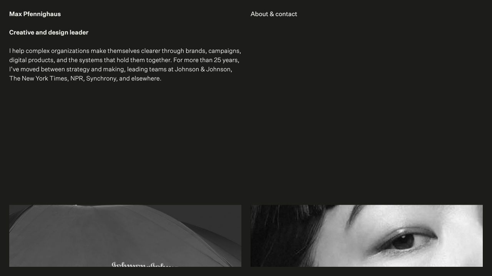

# Make Placid

Make Placid is a portfolio template for designers and creative studios. Edit the text in Markdown and YAML, put your media in `public/`, and use [Next.js](https://nextjs.org/) to build a site you can publish on a static host.

**[View the demo](https://maxpfennig.haus/make-placid-portfolio/)** / **[View it in use](https://maxpfennig.haus)** / **[Start a new repository](https://github.com/new?template_name=make-placid-portfolio&template_owner=mxpf)**



## What You Get

- A homepage with an optional introduction and a project list in the order you choose
- Project pages with a fixed summary column on desktop and a single column on phones
- Image grids and rows, swipe galleries on mobile, enlarged image views, videos, and HTML5 banners
- Light and dark themes, keyboard navigation, and support for reduced motion
- Share images for individual projects, WebP images generated at build time, and checks for content errors and missing files

## Requirements

- [Node.js](https://nodejs.org/) 22.13.0 or newer
- Git and npm. npm comes with Node.js.

## Quick Start

Use the template link above to create your own repository, or clone the demo to try it locally.

```bash
git clone --config core.autocrlf=false https://github.com/mxpf/make-placid-portfolio.git
cd make-placid-portfolio
npm ci
npm run dev
```

If you made your own repository, use its URL and folder name in the first two commands. Open the local address printed in the terminal. Edit your text and settings in [`content/`](content/) and put your media in [`public/`](public/).

On Windows, the clone command keeps LF line endings. If an existing checkout reports “Project files must begin with YAML frontmatter,” check that the `project.md` files use LF line endings.

## Make It Yours

### Set the site identity

Edit [`content/site.yml`](content/site.yml) to set your name, site address, contact details, and labels.

```yaml
name: "Your Name"
description: "Selected design and creative direction."
homepageTitle: "Creative direction and selected work."
homepageIntro: "A concise introduction to the practice and [selected work](https://portfolio.example.com)."
url: "https://portfolio.example.com"
language: "en"
locale: "en_US"
keywords:
  - "design"
  - "portfolio"
email: "studio@example.com"
location: "City, Country"
aboutLabel: "About & contact"
closeLabel: "Close"
projectsLabel: "Selected projects"
showProjectLabels: true
socialImage: "/og.png"
socialImageAlt: "Your Name - selected work"
favicon: "/favicon.png"
appleTouchIcon: "/apple-touch-icon.png"
```

`homepageIntro` accepts Markdown links. Leave out both `homepageTitle` and `homepageIntro` to start the homepage with the project list.

### Write the About page

Edit [`content/about.md`](content/about.md). The build fills in `{{name}}`, `{{email}}`, and `{{location}}` from [`content/site.yml`](content/site.yml).

About pages and project descriptions support paragraphs, headings up to level 3, lists, quotes, links, and basic formatting. Captions and `homepageIntro` use inline formatting such as links, bold, italics, and code. The build strips scripts, unsafe links, and unsupported HTML.

### Replace social and icon images

Replace [`public/og.png`](public/og.png) with a 1200 × 630 pixel image for link previews. If you rename the file, update `socialImage` in [`content/site.yml`](content/site.yml).

Replace [`public/favicon.png`](public/favicon.png) and [`public/apple-touch-icon.png`](public/apple-touch-icon.png) with square brand assets, then update their paths if needed.

To give a project its own preview, put an image of the same size in `public/social/projects/` and set `socialImage` in its `project.md`. Write the path as `/social/projects/project-slug.png`. Projects use the site-wide image by default.

### Choose typography

The template includes [Instrument Sans](https://github.com/Instrument/instrument-sans) under the SIL Open Font License. Its license lives at [`public/fonts/OFL.txt`](public/fonts/OFL.txt).

To use your own font, put a regular-weight WOFF2 file at `public/fonts/portfolio-custom.woff2`. Copy [`.env.example`](.env.example) to `.env.local` and set the font option there.

```text
NEXT_PUBLIC_PORTFOLIO_CUSTOM_FONT=true
```

The default is Instrument Sans. Git ignores `.env.local` and `portfolio-custom.woff2`. The build can still copy a font from `public/` into the published site, so only put it there if your license permits web use.

### Replace the demonstration assets

Replace the sample media with your own files in [`public/`](public/). One way to organize them is by project.

```text
public/
  images/
    project-name/
  videos/
    project-name/
  embeds/
    project-name/
```

Project paths begin after `public/`. For example, `public/images/project-name/cover.jpg` becomes `/images/project-name/cover.jpg`.

Use JPEG or PNG files under `public/images/` for automatic WebP generation. Choose source images at least as wide as you plan to show them.

## Projects

Put each project in its own folder under `content/projects/`.

```text
content/projects/
  project-name/
    project.md
```

The folder name becomes part of the URL. A published project at `content/projects/exhibition/project.md` appears at `/projects/exhibition/`.

Start with the YAML settings between the `---` lines, then write the project description in Markdown.

```markdown
---
title: "Exhibition Identity"
homepageLabel: "Exhibition"
homepageSubtitle: "Identity and environmental graphics"
seoDescription: "A concise exhibition identity across print and space."
socialImage: "/social/projects/exhibition.png"
order: 1
published: true
featured: true
colorMedia: false
thumbnail:
  src: "/images/exhibition/thumbnail.jpg"
  hoverSrc: "/images/exhibition/thumbnail-hover.jpg"
  alt: "Exhibition poster installed on a concrete wall"
  focalX: 50
  focalY: 42
  fit: "cover"
  scale: 1
evidence:
  role: "Creative direction and design"
  mandate: "Create a recognizable exhibition identity"
  scale: "Print, digital, and environmental applications"
  outcome: "A reusable system for the full exhibition program"
media:
  - kind: image
    id: "poster"
    src: "/images/exhibition/poster.jpg"
    ratio: "4 / 5"
    alt: "Black-and-white exhibition poster"
    caption: "Poster, **offset lithography**, 2026."
    captionPosition: "below"
    detail: true
---

# Exhibition Identity

A short introduction to the project.

More about the work and how it was made.
```

`order` sets the project sequence. Give each published project a different number. `published: false` skips the page at build time. `featured: false` keeps the published page and its sitemap entry while leaving it out of the homepage and Previous and Next links.

The first item in `media` is the lead. On desktop, the description sits beside the media. If the description starts with a level-one heading and a paragraph, phones show those first, followed by the lead media and the rest of the description.

`homepageLabel`, `homepageSubtitle`, `seoDescription`, and `socialImage` are optional. The homepage uses the project title when you leave out `homepageLabel`. Use `colorMedia: true` to show the original colors. Project media is grayscale by default.

### Homepage thumbnails

Homepage thumbnails use `--thumbnail-ratio`, which defaults to `1.618 / 1`. You can supply a separate crop for the homepage.

Use `focalX` and `focalY` to position a cropped image. Both accept values from `0` to `100`, with `50` as the center.

Use `fit: "cover"` to fill the frame or `fit: "contain"` to show the whole image. Use `scale` to adjust its size. Set `hoverSrc` to show a second image on desktop hover. Touch devices show that second image by default.

Set `showProjectLabels: true` in [`content/site.yml`](content/site.yml) to show labels and optional subtitles beneath thumbnails. Set it to `false` for an image-only homepage.

To preview the labels locally, set this in `.env.local`.

```text
NEXT_PUBLIC_SHOW_PROJECT_LABELS=true
```

## Media

Each gallery entry under `media` needs an `id` that is unique within the project. Captions accept inline Markdown. Use `captionPosition` to put a caption `"above"` or `"below"` its media.

### Image

```yaml
- kind: image
  id: "project-image"
  src: "/images/project/image.jpg"
  ratio: "4 / 5"
  alt: "A concise visual description"
  fit: "cover"
  position: "50% 40%"
  scale: 1
  detail: true
  border: false
  caption: "An optional caption with **inline formatting**."
  captionPosition: "below"
```

Standalone images open in an enlarged view on desktop and mobile. Set `detail: false` to turn that off for an image.

### Image grid

```yaml
- kind: image-grid
  id: "application-grid"
  ratio: "16 / 10"
  columns: 2
  gap: "2px"
  background: "#f0f0ed"
  border: true
  images:
    - src: "/images/project/application-a.jpg"
      alt: "First application"
    - src: "/images/project/application-b.jpg"
      alt: "Second application"
      fit: "contain"
```

The whole grid uses one aspect ratio and equal-width columns. Each image can have its own fit, position, and scale.

### Image row

```yaml
- kind: image-row
  id: "poster-row"
  gap: "24px"
  mobileGalleryLabel: "Poster series"
  caption: "A proportion-aware row of related work."
  images:
    - src: "/images/project/poster-a.jpg"
      alt: "First poster"
      width: 1200
      height: 1600
      detail: true
    - src: "/images/project/poster-b.jpg"
      alt: "Second poster"
      width: 1200
      height: 1600
```

Use each image's width and height to keep its proportions. On phones, the images stack by default. Set `mobileGalleryLabel` for a swipe gallery with Previous and Next buttons and keyboard controls. The images scroll to the edge of the screen while the heading and buttons stay in line with the rest of the page.

Set `detail: true` on an image to open it in the enlarged view.

### Mixed-media row

```yaml
- kind: media-row
  id: "process-row"
  gap: "24px"
  items:
    - kind: image
      src: "/images/project/storyboard.jpg"
      alt: "Storyboard sequence"
      width: 16
      height: 9
      detail: true
    - kind: video
      src: "/videos/project/motion-test.mp4"
      poster: "placeholder"
      title: "Motion test"
      autoplay: true
      controls: false
      playbackRate: 0.75
      width: 16
      height: 9
```

Mix images, hosted videos, and YouTube embeds in one row. Set `detail: true` on the images you want to enlarge. Hosted videos in rows autoplay by default. Set `autoplay: false` to start on click.

### Hosted video

```yaml
- kind: video
  id: "hosted-video"
  src: "/videos/project/film.mp4"
  poster: "/images/project/film-poster.jpg"
  ratio: "16 / 9"
  title: "Film title"
  controls: true
  audioControls: true
  playbackRate: 1
  caption: "An optional caption."
```

Use a file in `public/videos/` or an HTTPS video URL. Set `poster` to a local image or to `"placeholder"` for a plain play button.

Standalone videos start on click and show the browser's controls by default. Set `controls: true` for Make Placid's play and pause button, and add `audioControls: true` for a mute button.

Set `autoplay: true` to play a muted loop on the page. Autoplay respects the visitor's reduced-motion setting. When there is no visible play or pause button, visitors can select the video itself or focus it and press Enter or Space.

`playbackRate` defaults to `1` and accepts values from `0.0625` to `16`.

### YouTube

```yaml
- kind: youtube
  id: "youtube-video"
  youtubeId: "VIDEO_ID"
  poster: "/images/project/youtube-poster.jpg"
  ratio: "16 / 9"
  title: "Film title"
  caption: "An optional caption."
```

With a poster, the YouTube player loads when a visitor presses play. Without one, the privacy-enhanced embed loads when the page opens.

### HTML5 banner

```yaml
- kind: html5
  id: "campaign-banner"
  src: "/embeds/project-banner/index.html"
  width: 970
  height: 250
  title: "Animated campaign banner"
```

Keep the banner HTML and its assets together under `public/embeds/`. The banner scales to fit the page and runs in an isolated frame with pointer interactions disabled.

## Responsive Images

The build makes WebP copies at several widths so browsers can load an image that fits the screen. It uses [`public/images/responsive/manifest.json`](public/images/responsive/manifest.json) to reuse copies when the source stays the same. It replaces outdated copies and removes unused ones.

Your source files stay in the repository. The build leaves replaced sources out of `out/` when the page no longer links to them as a poster or share image. The published site serves the generated copies directly.

To generate images without building the site, run this command.

```bash
npm run images
```

## Using the Site

- Select a thumbnail to open its project. Use Previous or Next to browse featured projects. The left and right arrow keys also work when a control does not have focus.
- Select an image that supports enlargement to open it. Use the on-screen buttons or arrow keys to browse images. Select the image, use Close, or press Escape to close the view. Focus returns to the image you opened.
- Open About and use Close to return to where you were. Close works even before About finishes loading. If the previous page needs more time, the site waits until it can reach the saved position.
- Select the site name to go to the homepage.
- Use the switch in the header to choose light or dark mode. The site remembers the setting in your browser.

## Styling

Edit [`app/globals.css`](app/globals.css) to change the layout, spacing, or thumbnail shape. The desktop layout gives 38% of the column space to the summary and 62% to the work. Spacing uses steps of 12, 24, and 36 pixels.

The light and dark colors come from the Thinkinghaus v0.6 palette included in the repository. Change the color roles in [`packages/core/tokens.css`](packages/core/tokens.css). The [core package README](packages/core/README.md) explains the palette and how to use it for links, focus, and status colors.

## Project Structure

```text
app/                  Pages, metadata, and global styles
components/           Navigation, transitions, and project interactions
content/              Site identity, About copy, and project content
lib/content.ts        Content loading and validated project data
lib/content-schema.ts Strict YAML and media validation
lib/markdown.ts       Sanitized Markdown rendering
public/               Fonts, images, videos, embeds, and social assets
scripts/              Image generation and export verification utilities
tests/                HTML and browser tests
```

## Commands

| Command | Purpose |
| --- | --- |
| `npm run dev` | Start the local development server |
| `npm run images` | Generate responsive WebP image variants |
| `npm run build` | Create the static production export in `out/` |
| `npm run verify:export` | Check the export for missing local routes and assets |
| `npm test` | Build, verify the export, and check rendered routes |
| `npm run test:e2e` | Run browser and accessibility checks against an existing build |
| `npm run test:all` | Build and run the HTML and browser tests |
| `npm run lint` | Check source files |
| `npm run typecheck` | Check TypeScript without emitting files |
| `npm run audit:production` | Audit production dependencies |
| `npm run audit:full` | Audit production and development dependencies |

Run these checks before publishing. The browser tests use Chrome locally and Chromium in GitHub Actions. Run them with `NEXT_PUBLIC_BASE_PATH` empty.

```bash
npm run lint
npm run test:all
npm run typecheck
npm run audit:production
npm run audit:full
```

## Before Publishing Your Own Portfolio

- Replace the example name, biography, email address, and project copy.
- Review the demo images and video embeds. Replace the ones you don't want to publish.
- Replace `public/og.png`, favicon, and Apple touch icon.
- Update `url`, language, locale, keywords, and social-image text in `content/site.yml`.
- Confirm every meaningful image has accurate alternative text.
- Keep third-party media credits current.
- Run the verification commands.

## Deployment

`npm run build` writes the static site to `out/`. Upload the contents of that folder to your static host after running `npm run verify:export` with the same settings you used for the build.

Set `url` in [`content/site.yml`](content/site.yml) to your public address. `NEXT_PUBLIC_SITE_URL` can override it at build time. Leave `NEXT_PUBLIC_BASE_PATH` empty when the site lives at the root of a domain.

If the site lives under a path such as `/portfolio`, set both environment variables in your shell or hosting settings before you build and verify the export.

```dotenv
NEXT_PUBLIC_BASE_PATH=/portfolio
NEXT_PUBLIC_SITE_URL=https://your-name.github.io/portfolio
```

The included [GitHub Pages workflow](.github/workflows/publish-demo.yml) publishes the demo on pushes to `main`. It tests a build at the root, then builds and checks a second copy for the demo's public path.

To use it for your own site, change the two values in the workflow to match your URL. In your repository settings, open **Pages** and select **GitHub Actions** as the source under **Build and deployment**. [GitHub Pages setup guide](https://docs.github.com/en/pages/getting-started-with-github-pages/configuring-a-publishing-source-for-your-github-pages-site#publishing-with-a-custom-github-actions-workflow)

## Licensing

The code uses the [MIT License](LICENSE). Fonts, photos, and videos have their own terms. See [Third-party notices](THIRD_PARTY_NOTICES.md) and [Demo image credits](content/image-credits.md).

## Release Status

The template and its private `@make-placid/core` package are at `2.0.0-alpha.1`. The current demo is built from `main`. The content fields and shared CSS tokens may change before 2.0. See the [changelog](CHANGELOG.md) for release history.
